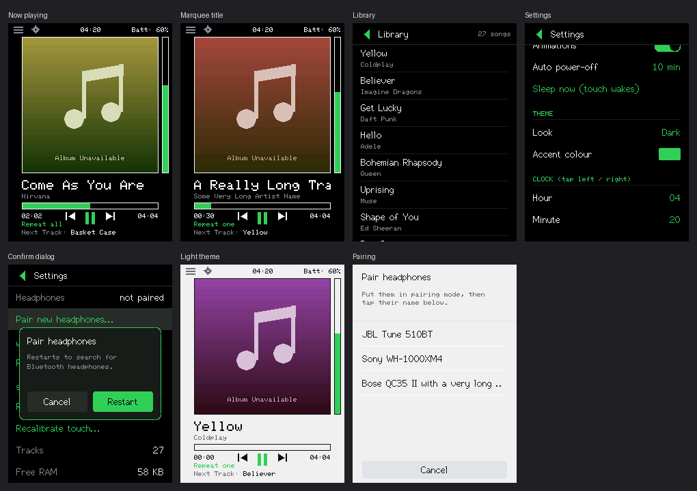

# MyPod — an iPod-style music player for the ESP32 "Cheap Yellow Display"

MyPod turns the **ESP32-2432S028** (a.k.a. CYD / "Cheap Yellow Display") into a
standalone, pocket-sized MP3 player:

- Music from a microSD card plays over **Bluetooth headphones / speakers**
  (A2DP source — the pod *is* the audio source).
- A smooth **240x320 touch UI** drawn straight to the display with TFT_eSPI
  (no widget toolkit, ~0 KB RAM for the UI itself) — the Now Playing screen
  follows the *KLIK MP3 Player* design from Lopaka.
- A **USB sync mode** and a PC program (`pc_sync/`, "MyPod Sync") that copies
  MP3s with their tags and **album covers** to the SD card over the USB cable.

No phone app, no cloud, no WiFi — just the pod, an SD card and
Bluetooth earphones.



---

## Features

| Area | What you get |
|---|---|
| **Library** | Scans `/music` on the SD card (up to 3 sub-folder levels, 800 tracks). Drag-to-scroll list with kinetic (flick) scrolling; only the visible rows are drawn, so hundreds of songs cost almost no RAM. Tap a song to play. |
| **Now playing** | 200x200 art area (the song's real album cover, or a placeholder), marquee title, artist, seek bar, elapsed / total time, vertical volume bar, prev / play-pause / next, playback mode (in order / repeat all / repeat one / shuffle), "next track" line, clock, battery or BT status. Swipe the art left/right for next/previous. |
| **Bluetooth** | A2DP source with auto-reconnect. First run opens a pairing picker; the chosen device is remembered and reconnected on every boot. |
| **Theme** | 4 looks — **Dark** (original), Midnight, Slate, **Light** — plus 8 accent colours (Red, Blue, Purple, Green, Orange, Pink, Cyan, Gold). Changes apply instantly (no restart) and recolour the whole UI. |
| **USB sync** | Separate boot mode (see below): the PC tool *MyPod Sync* sends songs + 200x200 covers over the USB cable straight to the SD card. |
| **Power saving** | Brightness with gamma curve, auto-brightness via the onboard light sensor, screen-off timeout (drawing stops, music keeps playing), CPU speed 80/160/240 MHz, auto deep-sleep when idle, manual sleep / screen-off. |
| **Touch** | XPT2046 resistive touch, bit-banged on its own pins, with a 3-target calibration on first boot. |
| **Audio engine** | Helix MP3 decoder (fixed-point, CPU-friendly) pinned to **core 1** — away from the Bluetooth stack — fed from a compressed **read-ahead ring** (8-24 KB of MP3 buffered ahead of the card) → 6 KB PCM ring → A2DP callback on the BT task. Mono and 22/24/32/48 kHz files are resampled on the fly. |

## Hardware

| Part | Detail |
|---|---|
| Board | ESP32-2432S028 2-USB version (2.8", ILI9341-family panel, XPT2046 touch) |
| Display | ILI9341-class driver over HSPI, 40 MHz, portrait 240x320 |
| Touch | XPT2046 bit-banged: CLK 25, MOSI 32, MISO 39, CS 33, IRQ 36 |
| SD card | VSPI: SCK 18, MISO 19, MOSI 23, CS 5 — FAT32 |
| RGB LED | R 4, G 16, B 17 (active LOW) — used as the status LED |
| Light sensor | GPIO 34 (auto-brightness) |
| BOOT button | GPIO 0 — held at power-up re-runs touch calibration |

All pins live in `src/config.h` if your board revision differs.

**Power:** the CYD has no charger or fuel gauge. Feed 5 V (USB or a
charger+boost module). Keep it ≤ 5 V. Battery percentage would need a voltage
divider on a free ADC pin — not implemented.

## Build & flash

1. Install [VS Code](https://code.visualstudio.com/) + the
   [PlatformIO extension](https://platformio.org/).
2. Open this folder — PlatformIO reads `platformio.ini` and installs the
   pinned toolchain and libraries on first build.
3. Plug the pod in, then **Upload** (or `pio run -t upload`). Serial monitor
   is 115200 baud.

Pinned dependencies (they matter — the BT audio stack breaks on newer cores):

| Library | Version |
|---|---|
| Platform | `espressif32@6.9.0` (Arduino-ESP32 2.x — **not** 3.x) |
| TFT_eSPI | `^2.5.43` |
| ESP32-A2DP | pschatzmann, master (**vendored, patched** — see below) |
| arduino-libhelix | pschatzmann, master |

### Vendored ESP32-A2DP patch

`lib/ESP32-A2DP` is the pschatzmann library vendored at upstream commit
`7da8b6e` (src + metadata, docs/examples removed) and patched for
Bluetooth stability. It is a **project-local lib** (no `lib_deps` entry),
so PlatformIO never reinstalls or overwrites it — fresh clones of this
repo get the patched code automatically:

1. `BluetoothA2DPSource.cpp → av_hdl_stack_evt()` — the AVRCP **controller**
   init is skipped (a source-only pod never sends AVRCP commands to the
   sink); its Bluedroid allocations were starving the A2DP connect burst.
2. The heart-beat timer start skips instead of asserting when
   `xTimerCreate` returns NULL under heap pressure.
3. `BluetoothA2DPCommon.cpp → bt_start()` — calls the stock Arduino
   `btStart()` (BTDM init) on IDF 4.x. A manual classic-only controller init
   is refused by the precompiled controller bundle with
   `ESP_ERR_INVALID_STATE` (error 259), with or without BLE memory released
   beforehand — which is why the app carries **no**
   `esp_bt_controller_mem_release` calls anywhere. The full analysis lives
   in the comment inside `bt_start()`.
4. `BluetoothA2DPSource.cpp → handle_audio_state()` — the A2DP audio state is
   stored even when no state callback is registered, so `get_audio_state()` is
   always usable.
5. `BluetoothA2DPSource.cpp → app_a2d_callback()` — the moment the headphones
   connect the source asks the stack to start streaming
   (`ESP_A2D_MEDIA_CTRL_CHECK_SRC_RDY`) instead of waiting up to 10 s for its
   heartbeat timer.
6. `BluetoothA2DPSource.cpp → handle_audio_state()` — if the sink suspends or
   stops the stream while the state machine still believes it is STARTED, the
   state is reset and streaming is re-requested (at most once a second).
7. `src/btfix.cpp` (app-side, not part of the lib) complements the above:
   it sets BR/EDR TX power to the maximum once the controller is up, and
   re-asks the stack to start the stream after 2.5 s of silence while a track
   is playing. With these fixes the pump rate measured 1169 → 1717 data
   callbacks per 5 s window (~68% → ~100% of real-time audio).

TFT pins/flags are set in `platformio.ini` via `USER_SETUP_LOADED` — no
`TFT_eSPI_User_Setup.h` needed. Flash layout is `huge_app.csv` (the firmware
is well under 2 MB).

## First boot

1. **Touch calibration** — tap the three targets. Saved to flash; redo via
   holding **BOOT** at power-up or Settings → Recalibrate touch.
2. **Pairing** — with no saved headphones, a pair screen opens. Put your
   earphones in pairing mode and tap their name. The pod restarts and
   reconnects automatically from then on.

## Usage

**Now playing** is the home screen. Top-left icons open the **Library**
(menu icon) and **Settings** (gear icon); each has a `<` back arrow.

| On Now playing | Gesture |
|---|---|
| Play / pause | tap the art, or the centre icon |
| Next / previous | swipe the art left / right, or tap the arrows next to the play icon |
| Seek | tap or drag the progress bar |
| Volume | tap or drag the vertical bar on the right |
| Mode | tap the mode text under the time (in order → repeat all → repeat one → shuffle) |

The clock has no RTC: set it in Settings → Clock. It survives deep sleep, not
a full power loss. The top-right shows the battery level only if you wire a
divider and set `BAT_ADC_PIN` in `config.h`; otherwise it shows the Bluetooth
state.

### Settings

| Setting | Effect |
|---|---|
| Brightness / Auto brightness | Backlight is the biggest battery consumer. |
| Screen off after | Backlight off and no drawing; music keeps playing; the waking touch is ignored. |
| CPU speed | 160 MHz default; 80 MHz saves power (watch for audio glitches). |
| Status LED | On = solid blue when headphones are connected, slow blink while searching, fully dark when disabled or the screen is off. |
| Animations | Off = no slide when the track changes. |
| Cover colours | Four modes — Normal / Swap red-blue / Invert / Swap + invert — for panels that draw the `/art` covers with wrong colours; each change repaints instantly. |
| Auto power-off | Deep sleep after N idle minutes when not playing. Touch wakes it. |
| Sleep now / Turn screen off now | Manual triggers for the above. |
| Volume limit | Caps maximum volume (hearing protection). |
| Rescan music library | Re-scans the SD card. |
| Recalibrate touch | Restart into the 3-target calibration. |

### Theme

- **Look** — Dark, Midnight, Slate, Light.
- **Accent colour** — eight colours; tap left / right of the row to step.

Both apply immediately. They are stored as their own NVS keys, so flashing
new firmware never resets them and your other settings survive untouched.

### USB sync (PC -> SD card)

Instead of pulling the card out, copy music over the USB cable you already use for flashing.
USB sync is a **separate boot mode** (no Bluetooth, no player) so the whole RAM is free.

1. On the pod: **Settings -> USB SYNC -> Copy songs from PC (USB)...** -> *Restart*.
   The screen shows "USB SYNC".
2. On the PC: install Python 3.9+ and run `pip install -r pc_sync/requirements.txt`, then
   `python pc_sync/mypod_sync.py` (details in `pc_sync/README.md`).
3. Pick the pod's COM port, press **Connect**, **Add files / Add folder**, press **Send to iPod**.
4. Press **Finish & start the player** (or hold BOOT for 3 s on the pod). The player re-scans
   the card automatically and the new songs appear.

What gets copied: the MP3 (named `Artist - Title.mp3` from its tags, which is what the library
list shows), its ID3 tags, and the album cover - converted on the PC to a 200x200 picture in
`/art/` on the card, so the pod only has to stream a small file to the screen. Progressive/PNG
covers work too, because the PC does the decoding.

The mode flag is stored in NVS, so if you power-cycle while the screen says USB SYNC it stays in
that mode until you exit (PC button or BOOT held 3 s).

### SD card

FAT32. Put MP3s in `/music` (sub-folders up to 3 levels are scanned; if
`/music` is missing, the root is scanned).

- Best: **44.1 kHz, stereo, 128–256 kbps MP3**. Mono and 22/24/32/48 kHz
  files are resampled on the fly.
- Title/artist come from ID3v2.3/2.4 tags, otherwise from
  `Artist - Title.mp3` file names.
- Only ASCII is drawn (the built-in fonts have no Arabic/CJK glyphs); other
  characters display as `?`.

## Architecture

```
Playback:  SD (VSPI) -> compressed read-ahead ring (8-24 KB of MP3)
           -> Helix MP3 decoder (core 1) -> 6 KB PCM ring
           -> A2DP callback (BT task, core 0) -> headphones
UI:        TFT_eSPI immediate-mode drawing on core 1 (main loop), TFT over HSPI;
           list rows composed in one 240x40 sprite when RAM allows (else drawn directly)
Touch:     XPT2046 bit-banged, own pins, 3-point calibration in NVS
USB sync:  framed, CRC-checked serial protocol (src/usbsync_engine.h, stop-and-wait 4 KB
           chunks) over the USB-UART bridge; PC side in pc_sync/
```

**Why USB sync is a separate boot:** the player runs with very little spare heap (Bluetooth + decoder). USB sync does not need Bluetooth, so it simply never starts it and gets the full RAM; the `usb` NVS flag decides which mode boots.

**RAM notes** (the ESP32 has 320 KB DRAM and BT + TLS both want it):

- v1.1 removed LVGL: **-48 KB static RAM** (45 KB widget pool + draw buffers).
- The Helix MP3 decoder (~26 KB) plus its 3 KB input and 4.6 KB PCM buffers
  are allocated **once at boot, BEFORE Bluetooth starts** (`setup()` calls
  `finishInit()` first). The BT stack then comes up against an
  already-pinned heap, so the A2DP connect dip lands around ~20 KB free
  instead of the ~8–9 KB floor that starved the SBC encoder and fopen at
  first play. (The old code allocated ~37 KB on *every song start*.)
- The PCM ring is 6 KB and the decoder task has a 6 KB stack (it never
  prints) — both trimmed from 16 / 8 KB to hand Bluetooth the heap it needs.
  Seeking still never tears the decoder down.
- Bluetooth runs as the stock `btStart()` **BTDM** init (~92 KB resident,
  + ~9 KB more when the headphones connect). There are **no**
  `esp_bt_controller_mem_release` calls anywhere: releasing BLE memory
  poisons the controller's released-region table, after which every init
  attempt is refused with `ESP_ERR_INVALID_STATE` (259). Details in the
  comment inside `lib/ESP32-A2DP/src/BluetoothA2DPCommon.cpp`.
- Before `a2dp.start()` the player waits up to ~15 s until ≥ 24 KB is free.
- The SD library keeps track paths relative to `/music` in a small index.
- Boot and the first 90 s print `[heap]` lines; `[player] 4s in:` prints heap
  and the decoder's minimum free stack once a song has played 4 seconds.
  Settings → System shows live free heap.

Measured boot ledger (this exact firmware — the USB-sync build, headphones
connected, 2 tracks on the SD card, read-ahead enabled):

| Step | Free heap after |
|---|---|
| Boot | ~221 KB |
| SD mount + library index | ~189 KB |
| Decoder pre-pin (Helix + buffers) | ~157 KB |
| Ring + decoder task | ~144 KB |
| BT init (BTDM), settled | ~51.6 KB |
| Headphones connected + 12 KB read-ahead buffer | ~26 KB |
| Playing | steady ~21 KB (min seen ~12.9 KB), underruns 0 |

## Troubleshooting

- **`SD: not found` at boot** — check the card is FAT32 and seated; the
  library will be empty and USB sync cannot save songs.
- **Pod restarts every few seconds, or when you pick a song** — heap
  exhaustion. Send the `[heap]` / `[player]` serial lines (115200 baud): they
  show where it ran out. The BT connect is gated: it waits for ≥ 24 KB free.
- **"Not enough memory" toast when playing** — the decoder could not be
  allocated at boot. Bluetooth is the dominant resident cost (~101 KB incl.
  the connect burst); `RING_BYTES` / `DEC_STACK` in `src/config.h` are
  already at the proven 6 KB / 6 KB, so look for other RAM consumers first.
- **Colours inverted / garbled** — add `-D TFT_INVERSION_ON=1`, or swap
  `ILI9341_2_DRIVER` for `ILI9341_DRIVER` / `ST7789_DRIVER` (varies by CYD
  revision). Upside-down: `TFT_ROT 2` in `src/config.h`.
- **A2DP compile error on `a2dp.start()`** — library version differences:
  some want `a2dp.start("")`. If the pair list stays empty, set
  `DEFAULT_BT_NAME` in `config.h` to your earphones' exact name.
- **Auto-brightness backwards** — flip `LDR_DARK_IS_HIGH` in `config.h`.
- **Audio stutter / 1-second cuts** — check the serial console counters first
  (115200 baud): `[audio]` (ring fill, underruns, slowest SD read), `[bt]`
  (callback pacing — a healthy link requests ~1720 calls per 5 s window; ~1170
  means the radio link is the bottleneck), `[bts]` (connect/disconnect events)
  and `[loop]` (UI-thread blocking). The fixes themselves are the vendored-lib
  patches above plus `src/btfix.cpp`. Also use CPU 160/240 MHz and don't
  cover the board's antenna area.
- **Serial shows `rst:(DEEP_SLEEP)` resets on its own** — that is the auto
  power-off deep sleep after ~1 idle minute without playback (Settings →
  Auto power-off), not a crash. Touch wakes the pod again.
- **Touch feels offset** — hold BOOT at power-up to recalibrate.

## Repository notes

- `pc_sync/` — the PC-side **MyPod Sync** program that sends MP3 files (with
  tags and album covers) to the iPod over USB; the firmware side is
  `src/usbsync.*` + `src/usbsync_engine.h`.
- `library.patch` — the exact diff applied to the vendored ESP32-A2DP library
  for the Bluetooth audio-cut fix.
- `.pio/` (build output, ~240 MB) and local logs are git-ignored.
- No secrets are committed or stored: there is no WiFi and no account of any kind.

## Known limits / ideas

MP3 only (no FLAC/WAV/AAC yet) · VBR files with a Xing/Info header get exact
durations, others are estimates · seek is byte-proportional · songs without an
embedded cover keep the "Album Unavailable" placeholder · no playlists ·
battery gauge needs an external divider · USB sync sends one file at a time.

## License

Released under the [MIT License](LICENSE). The vendored libraries keep their
upstream licenses — see the license files inside `lib/`.

## Album covers

The Now Playing screen shows a 200x200 cover from `/art/<hash>.cov` on the SD card (the hash is
FNV-1a of the song's path). The PC tool creates these files from the cover embedded in each MP3;
songs without one keep the "Album Unavailable" placeholder.

## Audio buffering (why music no longer cuts out)

Bluetooth asks for ~3.5 KB of audio every 20 ms, but the decoded-audio ring is only 6-16 KB
(35-90 ms), so any SD-card stall (50-300 ms is normal for SPI cards) or a burst of Bluetooth
work used to be heard as a cut. After Bluetooth connects, a reader task now keeps 8-24 KB of the
*compressed* MP3 read ahead (about a second of music at 128 kbps), the decoder runs on core 1 away
from the Bluetooth stack, and the CPU never drops below 240 MHz. The serial console prints a line
every 5 s (`[audio] underruns=... mp3buf=... slowest SD read=... ms`) that shows exactly what is
going on if you still hear a cut.
